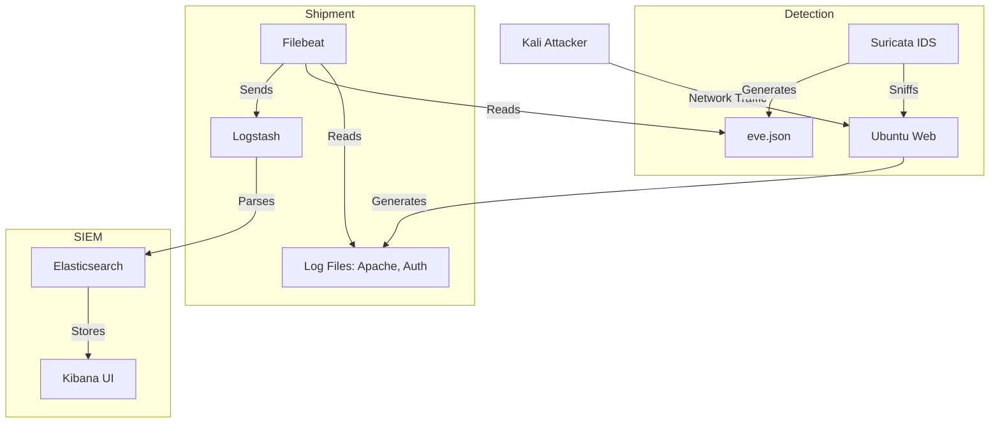

# SOC Detection Lab Architecture Map

This document outlines how the various files, configurations, and scripts in this project are linked together to create the SOC environment.

## 1. Core Orchestration
The project is driven by Docker Compose.

*   [docker-compose-minimal.yml](file:///home/guruvenu/SOC-Detection-Lab/docker-deployment/docker-compose-minimal.yml): **Main entry point** for low-memory environments. Defines all services and their interconnections.
*   [docker-compose.yml](file:///home/guruvenu/SOC-Detection-Lab/docker-deployment/docker-compose.yml): The full stack configuration (requires more RAM).
*   [.env](file:///home/guruvenu/SOC-Detection-Lab/docker-deployment/.env): Contains global variables like `ELASTIC_PASSWORD` and `SUBNET`.

## 2. Infrastructure (Dockerfiles)
Located in `dockerfiles/`, these define the custom systems used in the lab.

*   [Dockerfile.ubuntu-web](file:///home/guruvenu/SOC-Detection-Lab/docker-deployment/dockerfiles/Dockerfile.ubuntu-web): Web server target (Apache, SSH).
*   [Dockerfile.kali-attacker](file:///home/guruvenu/SOC-Detection-Lab/docker-deployment/dockerfiles/Dockerfile.kali-attacker): Attacking system (Nmap, Metasploit, etc.).
*   [Dockerfile.windows-sim](file:///home/guruvenu/SOC-Detection-Lab/docker-deployment/dockerfiles/Dockerfile.windows-sim): Python-based simulator for Windows Sysmon logs.

## 3. Security Stack Configurations
Located in `configs/`, these are mounted into containers to control their behavior.

### Suricata (IDS)
*   [suricata-minimal.yaml](file:///home/guruvenu/SOC-Detection-Lab/docker-deployment/configs/suricata/suricata-minimal.yaml): Optimized detection engine config.
*   [rules/custom.rules](file:///home/guruvenu/SOC-Detection-Lab/docker-deployment/configs/suricata/rules/custom.rules): Hand-written signatures for lab-specific attacks.

### ELK Stack (Logs)
*   [filebeat-minimal.yml](file:///home/guruvenu/SOC-Detection-Lab/docker-deployment/configs/filebeat/filebeat-minimal.yml): Instructions for which logs to collect (Suricata, Apache, Auth).
*   [pipeline/soc-pipeline.conf](file:///home/guruvenu/SOC-Detection-Lab/docker-deployment/configs/logstash/pipeline/soc-pipeline.conf): Logic for parsing JSON and enriching logs before they hit Elasticsearch.

## 4. Automation & Testing
Located in `scripts/` and `attack-scenarios/`.

*   [start_soc_lab.sh](file:///home/guruvenu/SOC-Detection-Lab/docker-deployment/start_soc_lab.sh): Helper to launch the minimal stack.
*   [test-suricata.sh](file:///home/guruvenu/SOC-Detection-Lab/docker-deployment/scripts/test-suricata.sh): Main validation script that triggers various tests.
*   [suricata-tests/](file:///home/guruvenu/SOC-Detection-Lab/docker-deployment/attack-scenarios/suricata-tests): Individual attack scripts (SQLi, Port Scans, etc.).

## 5. Linking Diagram (Data Flow)

